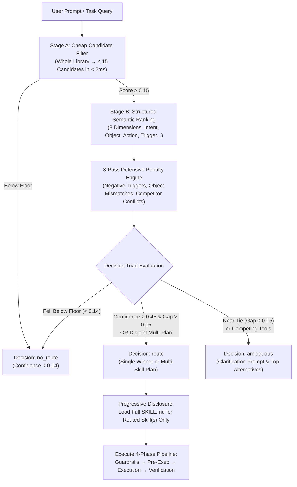

# Skills Router Meta-Skill (`skills-router-meta-skill`)

[](https://www.python.org/)
[](LICENSE)
[-brightgreen.svg)]()
[]()
[]()

A high-performance, deterministic meta-skill, routing engine, and lifecycle manager for autonomous AI coding agents (Antigravity, Gemini CLI, Claude Code, Cursor, Codex, and Aider).

Synthesizes the non-vectorized Agentic Search and progressive disclosure protocols from [`legendtkl/agentic-skill-router`](https://github.com/legendtkl/agentic-skill-router) with the two-stage deterministic ranking, 3-pass penalty engine, Decision Triad, and disjoint multi-skill plan synthesis from [`coderdoctor97/skill-router`](https://github.com/coderdoctor97/skill-router).

---

## ⚡ Key Highlights

- **Zero External Dependencies:** Built 100% on Python 3 standard library (`argparse`, `re`, `json`, `dataclasses`). Runs instantly on standard Linux, macOS, and Android (Termux ARM64).
- **Sub-35ms Deterministic Routing:** Eliminates embedding latency, vector database cold-starts, and API key dependencies.
- **Progressive Disclosure (>97% Token Savings):** Discovers skills by scanning lightweight YAML frontmatter ($< 25$ lines) instead of loading full 500-line skill bodies upfront. Reads full `SKILL.md` documents only on-demand after routing.
- **The Decision Triad:** Deterministically outputs `route` (confident execution), `ambiguous` (requests user choice on near ties), or `no_route` (reverts to natural conversation without hallucinating skill tools).
- **Minimal Disjoint Multi-Skill Plans:** Combines multi-disciplinary skills (e.g. offline form + database schema + Zod validation) into unified plans when tasks span independent facets.
- **Word-Boundary Safety:** Regex boundary matching prevents short-token collisions (e.g., `ed` matching `breeding`, `gr` matching `migration`).
- **Dormant Skill Lifecycle (`disable` / `enable`):** Silences unused or experimental skills by renaming `SKILL.md` $\leftrightarrow$ `SKILL.md.disabled` to keep prompt contexts clean without losing catalog history.
- **Precedence Hierarchy:** Project-level skills (`./.agents/skills/`, `./skills/`) strictly override global plugins (`~/.gemini/`, `~/.claude/`).
- **Canonical 4-Phase Pipeline:** Formats every selected skill set into:
  $$\text{Phase 1: Guardrails} \longrightarrow \text{Phase 2: Pre-Execution} \longrightarrow \text{Phase 3: Execution (TDD)} \longrightarrow \text{Phase 4: Verification}$$

---

## 🏗️ Architecture



---

## 📊 Two-Stage Routing vs. Vector Embeddings

| Feature | Vector Embeddings / LLM Routers | `skills-router-meta-skill` |
|---|---|---|
| **Latency** | $250 - 1500\text{ ms}$ | **$< 35\text{ ms}$** |
| **Token Overhead** | 30,000–50,000 tokens / turn | **$< 1,200\text{ tokens}$ ($>97\%$ savings)** |
| **Determinism** | Stochastic, shifts with prompt noise | **100% Deterministic & Reproducible** |
| **Dependencies** | Vector DB, OpenAI/Gemini API, PyTorch/Numpy | **Zero dependencies (Python stdlib)** |
| **Multi-Skill Planning** | Prone to duplicate categories | **Minimal disjoint plan synthesis** |
| **Offline / Air-Gapped** | Requires internet or heavy local models | **Runs fully offline & on mobile (Termux)** |

---

## 🚀 Quickstart

### 1. Installation
Clone the repository into your workspace:

```bash
git clone https://github.com/vijaychaudhari88/skills-router-meta-skill.git
cd skills-router-meta-skill
```

### 2. Run Tests
Execute the unit and integration test suite:

```bash
python3 -m unittest discover tests
```

### 3. Route a Task
Test how the router resolves an incoming prompt:

```bash
python3 scripts/skills_router.py route "build an offline form with Dexie persistence and Zod validation"
```

*Sample Output:*
```json
{
  "decision": "route",
  "status": "multi_skill_plan",
  "skill": "progressive-web-app",
  "skills": [
    "progressive-web-app",
    "database-design",
    "zod-validation-expert"
  ],
  "confidence": 0.64,
  "pipeline": {
    "Phase 1 (Guardrails)": ["using-superpowers", "agent-memory-discipline", "tokenleak"],
    "Phase 2 (Pre-Execution)": ["writing-plans"],
    "Phase 3 (Execution)": ["progressive-web-app", "database-design", "zod-validation-expert"],
    "Phase 4 (Verification)": ["verification-before-completion"]
  }
}
```

---

## 🛠️ CLI Reference

The router CLI provides 6 core subcommands:

```bash
# 1. Sync skills and compile SKILLS_REGISTRY.md and JSON manifest
python3 scripts/skills_router.py sync [--root .]

# 2. Route an incoming task query
python3 scripts/skills_router.py route "<query>" [--debug]

# 3. Run the calibrated benchmark suite
python3 scripts/skills_router.py benchmark

# 4. List all discovered skills, categories, scopes, and overrides
python3 scripts/skills_router.py list

# 5. Disable a dormant or legacy skill (renames SKILL.md -> SKILL.md.disabled)
python3 scripts/skills_router.py disable <skill-id>

# 6. Enable a dormant skill (renames SKILL.md.disabled -> SKILL.md)
python3 scripts/skills_router.py enable <skill-id>

# 7. Install or update harness contracts for all 6 major agent harnesses
python3 scripts/skills_router.py install-harness all [--target <path>]

# 8. Install integration for a specific harness (e.g. cursor, claude, windsurf)
python3 scripts/skills_router.py install-harness cursor --target .
```

---

## 🌐 Usability Across 6 Major Agent Harnesses

`skills-router-meta-skill` is engineered to work out-of-the-box across the **6 leading AI coding agent harnesses**. It provides automated, idempotent rule installation and tailored prompt contracts for each:

| Harness | Primary Files Configured | Activation Mechanism | Supported Features |
|---|---|---|---|
| **1. Claude Code** | `CLAUDE.md` | Pre-flight bash invocation via `BashTool` | Progressive disclosure, tool gating |
| **2. Gemini / Antigravity** | `AGENTS.md`, `GEMINI.md` | Constitutional comment fence block | Local sovereignty, subagents |
| **3. Cursor** | `.cursor/rules/skills-router.mdc`, `.cursorrules` | `alwaysApply: true`, `globs: "*"` | Composer / Agent context injection |
| **4. Windsurf / Cascade** | `.windsurf/rules/skills-router.md`, `.windsurfrules` | Frontmatter `trigger: always_on` | Cascade system prompt steering |
| **5. Roo Code & Cline** | `.roo/rules/00-skills-router.md`, `.clinerules` | Alphabetical workspace rule loading | Mode-specific / workspace context |
| **6. Aider** | `CONVENTIONS.md`, `.aider.conf.yml` | Repo-map auto-read conventions | Git pair-programming workflow |

### ⚡ One-Command Installation for Any Workspace

Run the `install-harness` command to automatically generate or update the configuration files in any target project:

```bash
# Configure all 6 harnesses in your project
python3 scripts/skills_router.py install-harness all --target /path/to/project

# Or configure specific harnesses:
python3 scripts/skills_router.py install-harness claude cursor windsurf --target .
```

The installer is **100% idempotent**: if a configuration file already exists, it cleanly replaces the `<!-- skills-manager:routing-contract:begin -->` block without overwriting your project-specific notes.

---

## 🧩 Harness-by-Harness Configuration Details

### 1. Claude Code (Anthropic)
- **Target File:** `CLAUDE.md`
- **Behavior:** Instructs Claude Code to execute `python3 scripts/skills_router.py route "<task>"` via its `BashTool` before creating execution plans or writing code.
- **Reference Template:** [`templates/harnesses/claude-code/CLAUDE.md`](templates/harnesses/claude-code/CLAUDE.md)

### 2. Gemini CLI & Antigravity (Google DeepMind)
- **Target Files:** `AGENTS.md` and `GEMINI.md`
- **Behavior:** Acts as a constitutional prefix for the agentReAct control loop, enforcing the 4-phase pipeline (`Guardrails → Pre-Execution → Execution → Verification`).
- **Reference Templates:** [`templates/harnesses/gemini-antigravity/`](templates/harnesses/gemini-antigravity/)

### 3. Cursor (Cursor AI IDE)
- **Target Files:** `.cursor/rules/skills-router.mdc` (and `.cursorrules` fallback)
- **Behavior:** Configured with `alwaysApply: true` so the rule is automatically injected into every Composer/Agent turn.
- **Reference Templates:** [`templates/harnesses/cursor/`](templates/harnesses/cursor/)

### 4. Windsurf (Codeium Cascade)
- **Target Files:** `.windsurf/rules/skills-router.md` (and `.windsurfrules` fallback)
- **Behavior:** Configured with `trigger: always_on` to ensure Cascade consults the router before generating file diffs.
- **Reference Templates:** [`templates/harnesses/windsurf/`](templates/harnesses/windsurf/)

### 5. Roo Code & Cline (VS Code Extensions)
- **Target Files:** `.roo/rules/00-skills-router.md` (and `.clinerules` fallback)
- **Behavior:** Prefixed with `00-` so it loads first alphabetically in Roo Code's workspace rules hierarchy.
- **Reference Templates:** [`templates/harnesses/roo-cline/`](templates/harnesses/roo-cline/)

### 6. Aider (CLI Pair Programmer)
- **Target Files:** `CONVENTIONS.md` and `.aider.conf.yml`
- **Behavior:** Configures Aider to read `CONVENTIONS.md` into context, guiding the LLM to inspect the router output before generating git commits.
- **Reference Templates:** [`templates/harnesses/aider/`](templates/harnesses/aider/)

---

## 📂 Repository Structure

```
skills-router-meta-skill/
├── .gitignore
├── LICENSE                          # MIT License
├── README.md                        # Documentation & Architecture Guide
├── skills/
│   └── skills-manager/
│       └── SKILL.md                 # The Canonical Meta-Skill Specification
├── scripts/
│   └── skills_router.py             # Two-Stage Deterministic CLI Router
├── tests/
│   └── test_skills_router.py        # Automated Unit & Integration Tests (11/11 passing)
└── templates/
    ├── AGENTS.md.snippet            # Universal trigger fence for agent prompts
    ├── example_skill/
    │   ├── SKILL.md                 # Example lightweight skill specification
    │   └── manifest.json            # Example rich capability manifest
    └── harnesses/                   # Ready-to-use configs for 6 major agent harnesses
        ├── claude-code/             # Claude Code (CLAUDE.md)
        ├── gemini-antigravity/      # Gemini CLI / Antigravity (AGENTS.md, GEMINI.md)
        ├── cursor/                  # Cursor (.cursor/rules/skills-router.mdc, .cursorrules)
        ├── windsurf/                # Windsurf (.windsurf/rules/skills-router.md, .windsurfrules)
        ├── roo-cline/               # Roo Code / Cline (.roo/rules/, .clinerules)
        └── aider/                   # Aider (CONVENTIONS.md, .aider.conf.yml)
```

---

## 🤝 Contributing

Contributions, issues, and feature requests are welcome! Feel free to check the [issues page](https://github.com/vijaychaudhari88/skills-router-meta-skill/issues).

---

## 📄 License

This project is licensed under the [MIT License](LICENSE).
