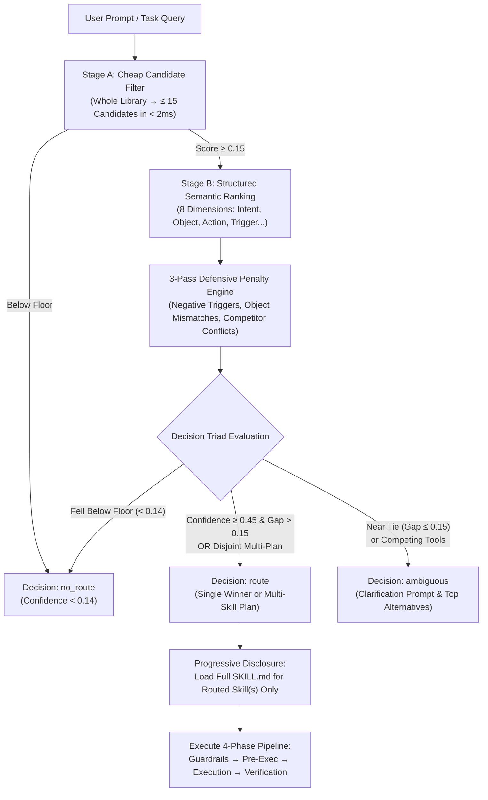

# Skills Router Meta-Skill (`skills-router-meta-skill`)

[](https://www.python.org/)
[](LICENSE)
[-brightgreen.svg)]()
[]()
[]()

A high-performance, deterministic meta-skill, routing engine, and lifecycle manager for autonomous AI coding agents (Antigravity, Gemini CLI, Claude Code, Cursor, Codex, and Aider).

Synthesizes the non-vectorized Agentic Search and progressive disclosure protocols from [`legendtkl/agentic-skill-router`](https://github.com/legendtkl/agentic-skill-router) with the two-stage deterministic ranking, 3-pass penalty engine, Decision Triad, and disjoint multi-skill plan synthesis from [`coderdoctor97/skill-router`](https://github.com/coderdoctor97/skill-router).

---

## ⚡ Key Highlights

- **Zero External Dependencies:** Built 100% on Python 3 standard library (`argparse`, `re`, `json`, `dataclasses`). Runs instantly on standard Linux, macOS, and Android (Termux ARM64).
- **Sub-35ms Deterministic Routing:** Eliminates embedding latency, vector database cold-starts, and API key dependencies.
- **Progressive Disclosure (>97% Token Savings):** Discovers skills by scanning lightweight YAML frontmatter ($< 25$ lines) instead of loading full 500-line skill bodies upfront. Reads full `SKILL.md` documents only on-demand after routing.
- **The Decision Triad:** Deterministically outputs `route` (confident execution), `ambiguous` (requests user choice on near ties), or `no_route` (reverts to natural conversation without hallucinating skill tools).
- **Minimal Disjoint Multi-Skill Plans:** Combines multi-disciplinary skills (e.g. offline form + database schema + Zod validation) into unified plans when tasks span independent facets.
- **Word-Boundary Safety:** Regex boundary matching prevents short-token collisions (e.g., `ed` matching `breeding`, `gr` matching `migration`).
- **Dormant Skill Lifecycle (`disable` / `enable`):** Silences unused or experimental skills by renaming `SKILL.md` $\leftrightarrow$ `SKILL.md.disabled` to keep prompt contexts clean without losing catalog history.
- **Precedence Hierarchy:** Project-level skills (`./.agents/skills/`, `./skills/`) strictly override global plugins (`~/.gemini/`, `~/.claude/`).
- **Canonical 4-Phase Pipeline:** Formats every selected skill set into:
  $$\text{Phase 1: Guardrails} \longrightarrow \text{Phase 2: Pre-Execution} \longrightarrow \text{Phase 3: Execution (TDD)} \longrightarrow \text{Phase 4: Verification}$$

---

## 🏗️ Architecture



---

## 📊 Two-Stage Routing vs. Vector Embeddings

| Feature | Vector Embeddings / LLM Routers | `skills-router-meta-skill` |
|---|---|---|
| **Latency** | $250 - 1500\text{ ms}$ | **$< 35\text{ ms}$** |
| **Token Overhead** | 30,000–50,000 tokens / turn | **$< 1,200\text{ tokens}$ ($>97\%$ savings)** |
| **Determinism** | Stochastic, shifts with prompt noise | **100% Deterministic & Reproducible** |
| **Dependencies** | Vector DB, OpenAI/Gemini API, PyTorch/Numpy | **Zero dependencies (Python stdlib)** |
| **Multi-Skill Planning** | Prone to duplicate categories | **Minimal disjoint plan synthesis** |
| **Offline / Air-Gapped** | Requires internet or heavy local models | **Runs fully offline & on mobile (Termux)** |

---

## 🚀 Quickstart

### 1. Installation
Clone the repository into your workspace:

```bash
git clone https://github.com/vijaychaudhari88/skills-router-meta-skill.git
cd skills-router-meta-skill
```

### 2. Run Tests
Execute the unit and integration test suite:

```bash
python3 -m unittest discover tests
```

### 3. Route a Task
Test how the router resolves an incoming prompt:

```bash
python3 scripts/skills_router.py route "build an offline form with Dexie persistence and Zod validation"
```

*Sample Output:*
```json
{
  "decision": "route",
  "status": "multi_skill_plan",
  "skill": "progressive-web-app",
  "skills": [
    "progressive-web-app",
    "database-design",
    "zod-validation-expert"
  ],
  "confidence": 0.64,
  "pipeline": {
    "Phase 1 (Guardrails)": ["using-superpowers", "agent-memory-discipline", "tokenleak"],
    "Phase 2 (Pre-Execution)": ["writing-plans"],
    "Phase 3 (Execution)": ["progressive-web-app", "database-design", "zod-validation-expert"],
    "Phase 4 (Verification)": ["verification-before-completion"]
  }
}
```

---

## 🛠️ CLI Reference

The router CLI provides 6 core subcommands:

```bash
# 1. Sync skills and compile SKILLS_REGISTRY.md and JSON manifest
python3 scripts/skills_router.py sync [--root .]

# 2. Route an incoming task query
python3 scripts/skills_router.py route "<query>" [--debug]

# 3. Run the calibrated benchmark suite
python3 scripts/skills_router.py benchmark

# 4. List all discovered skills, categories, scopes, and overrides
python3 scripts/skills_router.py list

# 5. Disable a dormant or legacy skill (renames SKILL.md -> SKILL.md.disabled)
python3 scripts/skills_router.py disable <skill-id>

# 6. Enable a dormant skill (renames SKILL.md.disabled -> SKILL.md)
python3 scripts/skills_router.py enable <skill-id>
```

---

## 🧩 Project Integration

To integrate the router into your project's agent constitution (`AGENTS.md` or `CLAUDE.md`), add this idempotent comment fence:

```markdown
<!-- skills-manager:routing-contract:begin -->
### Autonomous Skills Router Contract
Before modifying code, designing architecture, or executing sub-tasks:
1. Pre-Flight Routing Query:
   python3 scripts/skills_router.py route "<user intent or task description>"
2. Decision Triad Protocol:
   - route: Follow selected skill or disjoint multi-skill plan.
   - ambiguous: Ask user to choose between top candidates.
   - no_route: Proceed with generalist reasoning without hallucinating skill activations.
3. Local Sovereignty: Project skills in ./.agents/skills/ and ./skills/ strictly override global plugins.
4. Lifecycle: Manage dormant skills via disable and enable commands.
<!-- skills-manager:routing-contract:end -->
```

---

## 📂 Repository Structure

```
skills-router-meta-skill/
├── .gitignore
├── LICENSE                          # MIT License
├── README.md                        # Documentation & Architecture Guide
├── skills/
│   └── skills-manager/
│       └── SKILL.md                 # The Canonical Meta-Skill Specification
├── scripts/
│   └── skills_router.py             # Two-Stage Deterministic CLI Router
├── tests/
│   └── test_skills_router.py        # Automated Unit & Integration Tests
└── templates/
    ├── AGENTS.md.snippet            # Copy-pasteable trigger fence for agents
    └── example_skill/
        ├── SKILL.md                 # Example lightweight skill specification
        └── manifest.json            # Example rich capability manifest
```

---

## 🤝 Contributing

Contributions, issues, and feature requests are welcome! Feel free to check the [issues page](https://github.com/vijaychaudhari88/skills-router-meta-skill/issues).

---

## 📄 License

This project is licensed under the [MIT License](LICENSE).
