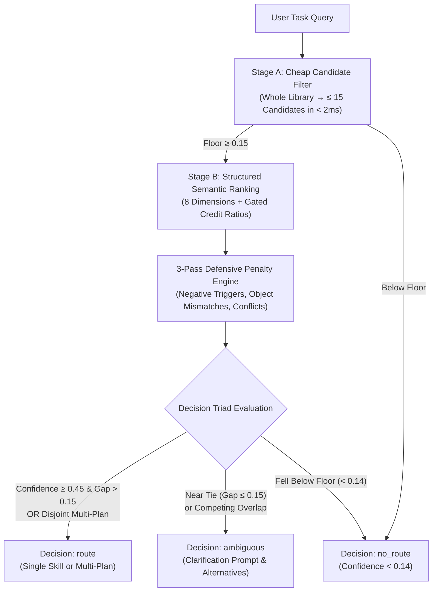
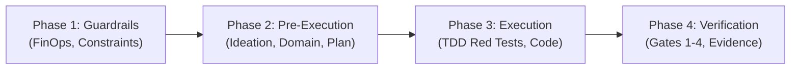

# Skills Manager & Autonomous Skill Router

## Overview

**Skills Manager** is an enterprise-grade meta-skill and deterministic routing engine designed for token-constrained agent environments (including Termux on Android ARM64, Gemini CLI, Claude Code, and Antigravity). 

Synthesizing the non-vectorized Agentic Search and progressive disclosure protocols from `legendtkl/agentic-skill-router` with the two-stage deterministic routing engine, 3-pass penalty calculations, and Decision Triad from `coderdoctor97/skill-router`, this system delivers $< 35\text{ ms}$ sub-millisecond routing across 140+ project and global skills with zero external vector databases, zero embedding API dependencies, and zero context window bloat.

### Core Architectural Principles
1. **Two-Stage Deterministic Routing:** Fast Stage A cheap filter ($\le 15$ candidates, $\ge 0.15$ score) followed by Stage B structured 8-dimension semantic ranking.
2. **Progressive Disclosure First:** Never ingest full skill bodies during discovery or routing. Discover via lightweight YAML frontmatter ($< 25$ lines); return opaque references and load full `SKILL.md` documents only on demand.
3. **The Decision Triad:** Every query resolves deterministically to `route`, `ambiguous` (requesting user clarification), or `no_route` (reverting to generalist reasoning without hallucinated skill triggers).
4. **Minimal Disjoint Multi-Skill Plans:** Automatically assemble composite multi-skill plans when a task spans independent facets (e.g. offline form + Dexie storage + Zod validation) without duplicate categories or conflicting tools.
5. **3-Pass Defensive Penalties:** Soft negative trigger penalties ($\times 0.60$) for mixed requests, object mismatch discounts, and competitor conflict penalties.
6. **Dormant Skill Lifecycle (`disable` / `enable`):** Silence inactive or legacy skills by renaming `SKILL.md` to `SKILL.md.disabled`, keeping them catalogued in offline registries without polluting live LLM prompt contexts.
7. **Local Sovereignty Invariant:** Project-level skills (`./.agents/skills/`, `./skills/`) strictly override and supersede matching global runtime plugins.
8. **Pre-Flight Pipeline Declaration:** Before executing code or modifying files, structure active skills into the canonical 4-phase pipeline: `Guardrails → Pre-Execution → Execution → Verification`.

---

## 1. Two-Stage Deterministic Routing Engine

To eliminate high latency and token costs associated with vector embeddings or full LLM passes over large skill catalogs, the router uses a two-stage deterministic pipeline:



### Stage A: Cheap Candidate Filtering
Filters the entire skill catalog ($100+$ skills) down to at most 15 candidates in $< 2\text{ ms}$:
- **Name Match ($0.60$):** Word-boundary match of skill name or hyphen-spaced name.
- **Alias Match ($0.55$):** Word-boundary match of canonical acronyms or aliases (e.g., `tdd` $\leftrightarrow$ `test-driven-development`).
- **Trigger Coverage ($0.45$):** Gated credit ratio ($\ge 0.5$) against `use_when` clauses.
- **Intent Match ($0.35$):** Semantic intent keyword overlap.
- **Object Match ($0.18$):** Domain entity match (`milk`, `cow`, `dexie`, `viewport`).
- **Action Match ($0.16$):** Operation verb match (`calculate`, `migrate`, `audit`).
- **Keyword Match ($0.25$):** Bounded keyword match.

*Filter Floor:* Candidate cheap score must be $\ge 0.15$.

### Stage B: 8-Dimension Structured Semantic Ranking
Evaluates surviving candidates across 8 calibrated dimensions normalized by weight sum ($1.39$):

| Dimension | Weight | Description & Credit Policy |
|---|---|---|
| `intent` | **0.35** | High-level goal match (`calculate gestation`, `dexie migration`, `audit viewport`). |
| `object` | **0.18** | Concrete domain entities (`cow`, `pwa`, `dexie`, `wcag`). Multi-word checks require $\ge 0.5$ token ratio. |
| `action` | **0.16** | Specific operations (`calculate`, `test`, `audit`, `migrate`, `style`). |
| `capability` | **0.16** | Feature capability overlap from skill manifest. |
| `trigger` | **0.14** | Exact `use_when` triggers scored by length and token density ($0.4 + 0.12 \times \text{tokens}$). |
| `name_alias` | **0.16** | Word-boundary name ($1.0$) or alias ($0.9$) presence. |
| `domain` | **0.16** | Functional domain tags (`agritech`, `ui`, `offline`, `testing`). |
| `specificity` | **0.08** | Number of distinct matched evidence dimensions ($\min(1.0, N \times 0.2)$). |

#### Anti-Adversarial Anchor Invariant
A match on skill name or alias alone without an associated task anchor (concrete object, intent, or domain) is prevented from dominating. Name bonuses ($+0.25$) are only awarded when corroborated by an object, intent, or domain match.

---

## 2. 3-Pass Defensive Penalty Engine

Raw scores are passed through three defensive penalty filters to eliminate false-positive collisions and resolve competing tools:

### Pass 1: Negative Boundaries (`not_when`)
- **Soft Penalty ($\times 0.60$):** When a task contains mixed criteria matching a skill's `not_when` boundary (e.g. "redesign layout without changing color scheme"), apply a soft discount if positive anchors exist.
- **Hard Disqualification ($\times 0.15$):** If the negative trigger matches and there are no strong positive anchors (`intent + object < 0.2`), disqualify the candidate.

### Pass 2: Object Mismatch Penalty
If a skill defines explicit domain objects (`objects: [...]`) and the incoming task query mentions concrete objects that do NOT match any of the skill's objects, apply an object mismatch penalty ($\times 0.85$).

### Pass 3: Competitor Conflict Penalty
When two candidates in the top set are marked as mutually conflicting (`conflicts_with`), and both have high confidence, the lower-confidence generic tool receives a conflict penalty:
$$\text{confidence} = \text{confidence} - 0.30$$

---

## 3. The Decision Triad

Every routing query produces one of three deterministic decisions:

```
                  ┌───────────────────────┐
                  │    Decision Triad     │
                  └──────────┬────────────┘
         ┌───────────────────┼───────────────────┐
         ▼                   ▼                   ▼
    ┌─────────┐        ┌───────────┐       ┌──────────┐
    │  route  │        │ ambiguous │       │ no_route │
    └─────────┘        └───────────┘       └──────────┘
```

1. **`route` (Clear Winner or Disjoint Multi-Plan):**
   - Single winner: $\text{Confidence} \ge 0.45$ and lead over runner-up $> 0.15$ (or runner-up confidence $< 0.14$).
   - Multi-skill plan: Task explicitly connects independent facets with conjunctions (`and`, `with`, `then`, `plus`), and top candidates cover disjoint categories or objects with confidence $\ge 0.33$.
   - **Action:** Declare the 4-phase pipeline and execute following the selected skill(s).

2. **`ambiguous` (Competing Options or Near Tie):**
   - Triggered when the top two candidates both score above $0.14$ but the gap is $\le 0.15$ (e.g. `frontend-design` vs `hallmark` on "redesign landing page layout").
   - **Action:** Pause execution, present the competing choices to the user, and ask for clarification before writing code.

3. **`no_route` (Generalist Reasoning):**
   - Triggered when all candidates fall below the noise floor ($< 0.14$) (e.g. "what is the weather in Mumbai").
   - **Action:** Do NOT force or hallucinate a skill invocation. Proceed with standard generalist reasoning.

---

## 4. Minimal Disjoint Multi-Skill Plans

When user tasks require multiple specialized capabilities, the router synthesizes a **minimal disjoint plan**:

### Multi-Plan Invariant Rules
1. **Explicit Conjunction Gate:** Multi-skill plans are triggered only when tasks contain syntactic connectives (`and`, `with`, `then`, `plus`, `also`, `&`). Single focused phrases resolve to a single winner or `ambiguous`.
2. **Disjoint Responsibility:** Each skill in the plan must represent either a distinct functional category (`Planning`, `Implementation`, `Domain`, `Verification`) OR cover a distinct domain object (`dexie` vs `milk`).
3. **Conflict Exclusion:** Mutually conflicting skills (`conflicts_with`) are never combined in the same plan.
4. **Plan Cap:** Multi-skill plans are capped at at most 4 skills to avoid token exhaustion.

*Example Output:*
```json
{
  "decision": "route",
  "status": "multi_skill_plan",
  "skills": ["progressive-web-app", "database-design", "zod-validation-expert"],
  "confidence": 0.64,
  "pipeline": {
    "Phase 1 (Guardrails)": ["using-superpowers", "agent-memory-discipline", "tokenleak"],
    "Phase 2 (Pre-Execution)": ["writing-plans"],
    "Phase 3 (Execution)": ["progressive-web-app", "database-design", "zod-validation-expert"],
    "Phase 4 (Verification)": ["verification-before-completion"]
  }
}
```

---

## 5. Progressive Disclosure & Token Budget Optimization

Traditional agent workflows blow context limits by reading complete 200–500 line `SKILL.md` documents during initial discovery. **Skills Manager enforces a two-tier disclosure boundary:**

| Stage | What Is Loaded | Token Footprint |
|---|---|---|
| **Reconnaissance & Routing** | YAML frontmatter (`name`, `description`, tags) | $\approx 25\text{ tokens/skill}$ |
| **Execution** | Full `SKILL.md` of *routed* skill(s) only | Bounded to active task |

### Token Savings
Across a library of 145 skills:
- Full upfront ingestion: $145 \times 350\text{ lines} \approx 45,000\text{ tokens}$.
- Frontmatter discovery + deterministic routing: $< 1,200\text{ tokens}$ ($> 97\%$ reduction).

---

## 6. Dormant Skill Lifecycle (`disable` / `enable`)

To keep specialized, experimental, or legacy skills catalogued without polluting active LLM prompt contexts:

- **Disable:** Silences a skill by renaming its definition file:
  `SKILL.md` $\longrightarrow$ `SKILL.md.disabled`
  - Excluded from Stage A candidate filtering.
  - Retained in `SKILLS_REGISTRY.md` marked as `(Disabled)`.
  - Accessible for historical reference.
- **Enable:** Re-activates a dormant skill:
  `SKILL.md.disabled` $\longrightarrow$ `SKILL.md`
  - Immediately restored to active routing and synced.

*CLI Execution:*
```bash
python3 scripts/skills_router.py disable test-dormancy
python3 scripts/skills_router.py enable test-dormancy
```

---

## 7. Precedence & Deduplication Hierarchy

When skills share identical names across project and global paths, resolve them using strict Local Sovereignty:

```
[Project Local: ./.agents/skills/ & ./skills/]  ──> WINS (Priority: 100)
                    │
                    ▼  (if not found locally)
[Project Config: ./.antigravity/skills/]        ──> WINS (Priority: 90)
                    │
                    ▼  (if not found in project)
[Global Plugin: ~/.gemini/config/plugins/...]   ──> FALLBACK (Priority: 50)
                    │
                    ▼  (if not found in plugins)
[Global User: ~/.claude/skills/, ~/.agents/...] ──> FALLBACK (Priority: 40)
```

### Invariant Rules
- **Rule of Local Sovereignty:** A local project skill completely masks and supersedes any globally installed plugin with the same name.
- **Deduplication Ledger:** Duplicate skills are collapsed into a single entry in `SKILLS_REGISTRY.md` denoting `[Project Override]`.

---

## 8. Standard 6-Category Domain Taxonomy

All skills are mapped into exactly one primary domain category:

```
┌───────────────────────────────────────────────────────────────────────┐
│                          SKILLS TAXONOMY                              │
├──────────────────────────┬────────────────────────────────────────────┤
│ 1. Planning              │ Architecture, Ideation, Task Breakdown     │
│ 2. Implementation        │ Frontend, Backend, UI/UX, State, APIs      │
│ 3. Debugging/Verify      │ TDD, Browser Automation, Quality Gates     │
│ 4. Token Economy         │ Context Pruning, Memory FinOps, Ledgers    │
│ 5. Domain/Infrastructure │ Agritech Logic, IndexedDB, PWA Offline     │
│ 6. Meta/Authoring        │ Skill Authoring, Governance, Superpowers   │
└──────────────────────────┴────────────────────────────────────────────┘
```

---

## 9. Pre-Flight 4-Phase Execution Pipeline

Before writing code or running commands, structure selected skills into the canonical 4-phase pipeline:



### Pipeline Phase Invariants
- **Phase 1 (Guardrails):** Enforces token limits and system rules (`using-superpowers`, `agent-memory-discipline`, `tokenleak`). Always active.
- **Phase 2 (Pre-Execution):** Ideation, domain rules, and plan authoring (`brainstorming`, `writing-plans`, `dairy-agritech-domain`). **ZERO production code written here.**
- **Phase 3 (Execution):** Strictly Red-Green-Refactor implementation (`test-driven-development`, `zod-validation-expert`, `database-design`).
- **Phase 4 (Defensive Verification):** Proof of correctness before assertions (`verification-before-completion`, `chrome-devtools`, `a11y-debugging`).

---

## 10. CLI Reference & Verification Commands

All router operations are exposed via a zero-dependency Python 3 standard library script:

```bash
# 1. Sync skills and rebuild SKILLS_REGISTRY.md & routing-manifest.json
python3 scripts/skills_router.py sync

# 2. Route an incoming task query
python3 scripts/skills_router.py route "calculate Cow gestation window and pregnancy check date"

# 3. Route with full score breakdown and debug candidate inspection
python3 scripts/skills_router.py route "write Dexie migration for cattle breeding tables" --debug

# 4. Run the gold-set benchmark test suite (< 35ms evaluation)
python3 scripts/skills_router.py benchmark

# 5. List all active and disabled skills with scope and overrides
python3 scripts/skills_router.py list

# 6. Disable a dormant or legacy skill
python3 scripts/skills_router.py disable <skill-id>

# 7. Enable a dormant skill
python3 scripts/skills_router.py enable <skill-id>
```

### POSIX Fallback Shell Extractor
For environments where Python is temporarily unavailable:
```bash
for base in "./.agents/skills" "./skills" "$HOME/.gemini/config/plugins"/*"/skills"; do
  [ -d "$base" ] || continue
  find "$base" -maxdepth 3 -name "SKILL.md" 2>/dev/null | while read -r skill_file; do
    awk -v path="$skill_file" '
      BEGIN { in_fm=0; name=""; desc="" }
      /^---$/ {
        in_fm++
        if (in_fm == 2) {
          if (name != "") print path "\t" name "\t" desc
          exit
        }
        next
      }
      in_fm == 1 && /^name:/ { sub(/^name:[ \t]*/, ""); name = $0 }
      in_fm == 1 && /^description:/ { sub(/^description:[ \t]*/, ""); desc = $0 }
      NR > 25 { exit }
    ' "$skill_file"
  done
done
```

---

## 11. Rationalization Counter Table

| Agent Rationalization | Why It Fails | Mandated Counter Action |
|---|---|---|
| *"I will read all full SKILL.md files to be certain."* | Consumes 45,000+ unnecessary tokens, triggering context exhaustion. | Read only lightweight frontmatter. Query `scripts/skills_router.py route "<query>"`. |
| *"The global plugin skill is newer than the project skill."* | Project skills embed critical local invariants, domain formulas, and local schemas. | Project skill always overrides global skill. No exceptions. |
| *"The task is small, so I will code immediately without routing."* | Leads to broken domain invariants and missed testing gates. | Run the router, declare the 4-phase pipeline, write failing test first. |
| *"I'll use vector embeddings for routing instead."* | Introduces network latency, API key fragility, and non-deterministic behavior. | Use deterministic two-stage ranking and 3-pass penalties. |
| *"I'll combine competing design skills into one plan."* | Causes contradictory stylistic directives and confusion. | When two tools conflict, return `ambiguous` and prompt user for selection. |

---

## 12. Red Flags & Violations

- 🚩 Loading a full `SKILL.md` body during an initial discovery or reconnaissance turn.
- 🚩 Choosing a global plugin when an equivalent project skill exists in `./skills/` or `./.agents/skills/`.
- 🚩 Writing production code without declaring the 4-phase execution pipeline.
- 🚩 Substring collisions matching short aliases (e.g. `ed`, `gr`) inside larger words.
- 🚩 Forcing a skill execution when router returns `no_route`.
- 🚩 Ignoring ambiguity warnings when router returns `ambiguous`.
